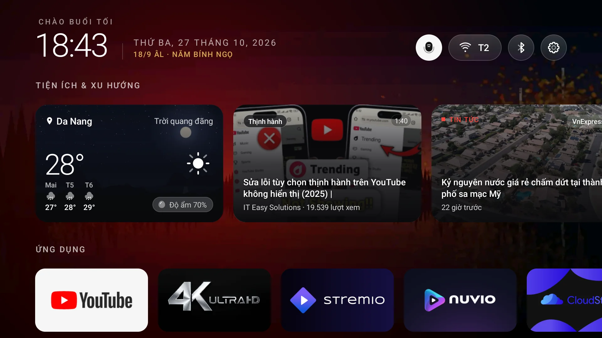
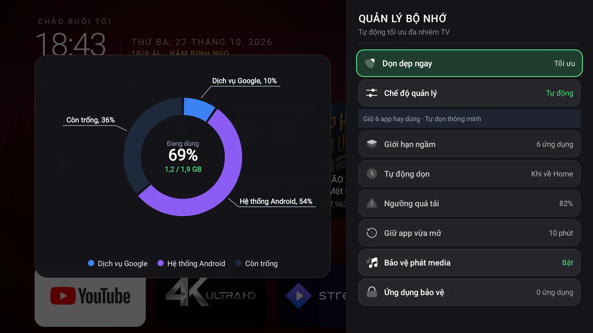
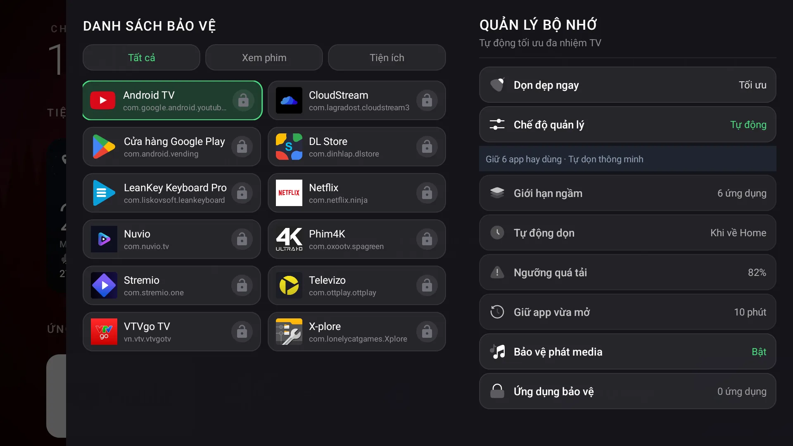
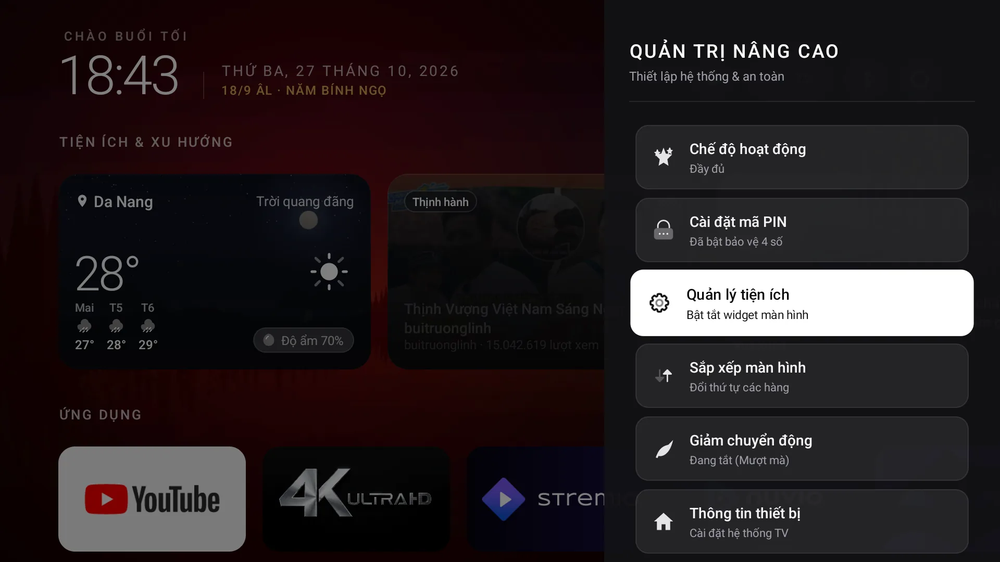
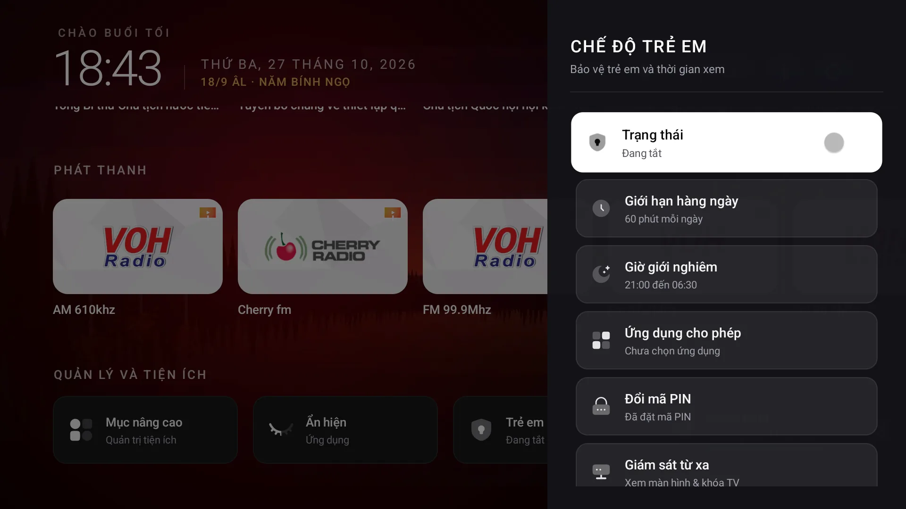
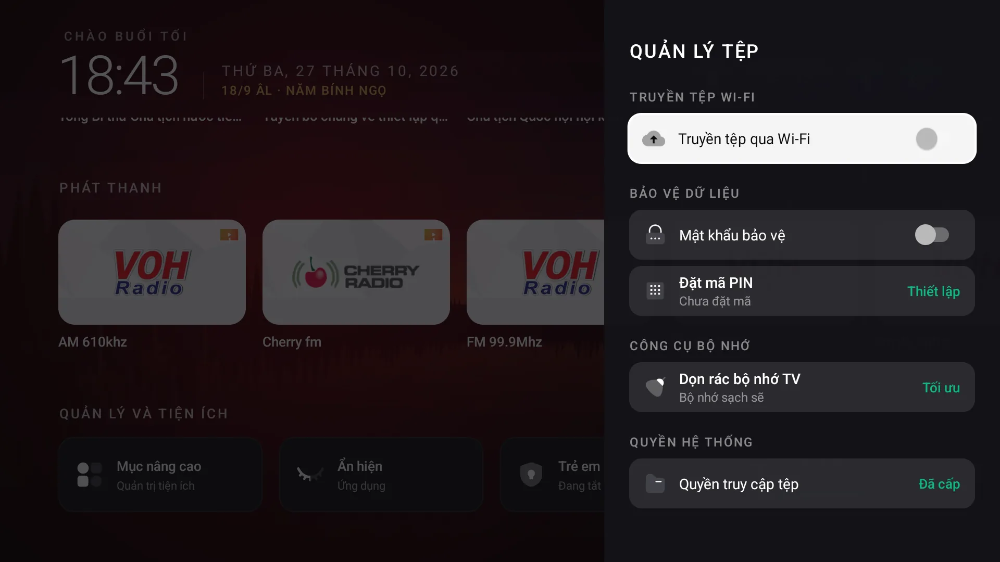
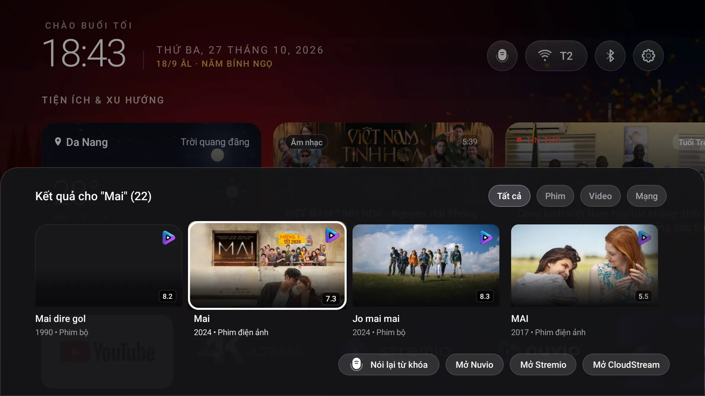

<p align="center">
  
</p>

<h1 align="center">NextTV Launcher</h1>

<p align="center">
  <b>Next-generation, ultra-fast, privacy-first Android TV launcher inspired by Apple tvOS.</b><br />
  Tailored specifically for constrained hardware (1 GB - 1.5 GB RAM) with Zero Telemetry, Fluid Glass Focus, and Native C++ Vault Security.
</p>

<p align="center">
  
  
  
  
  
</p>

---

## Overview

**NextTV** is a standalone, lightweight, open-source Android TV launcher built from the ground up for speed, responsiveness, and aesthetic minimalism. Unlike standard stock launchers weighed down with unskippable advertisements, sponsored banners, and background analytical telemetry, NextTV gives full control back to the user.

- **Ultra-Lean Resource Footprint**: Active memory stays around **60 MB - 80 MB PSS**, well below the 150 MB ceiling for budget TV boxes and smart dongles.
- **Microsecond Cold-Start**: Plain Java + Native C++ NDK runtime without heavy JVM frameworks or unnecessary reflection.
- **Enterprise-Grade Secret Defense**: Strict implementation of Level 4 Backend-For-Frontend (BFF) Cloudflare Worker proxy and Level 3 Native NDK Vault with SHA-256 self-poisoning anti-tamper protection.

---

## Visual Showcase

| Home Screen & Ambient Hero | Physical RAM Governor & Donut Chart |
|:---:|:---:|
|  |  |

| Protected Apps Grid (2-Column) | Advanced Settings & Master-Detail |
|:---:|:---:|
|  |  |

| Kid Mode & PIN Quota | Wi-Fi File Manager & Web Remote (Bento UI) |
|:---:|:---:|
|  |  |

| Universal Spotlight & Voice Search | Live Sports Scores & Real-Time Widgets |
|:---:|:---:|
|  |  |

---

## Core Features

### 1. Apple tvOS Fluid Aesthetics
- **Fluid Glass Focus**: High-contrast, dynamic glass focus frame with smooth physics-based interpolation.
- **Ambient Hero Lighting**: Automatic backdrop atmospheric glow and wallpaper tint adaptation.
- **2:3 Cinematic Posters & Episode Badges**: First-class support for Leanback recommendation channels with vertical 2:3 card geometry and `SxEy` episode pill badges.

### 2. Physical Memory Governor & Donut Cleaner
- **Zero-Fakery Memory Optimization**: Eliminates synthetic app killing; interacts directly with Linux kernel OOM killer and local ADB loopback to release hundreds of megabytes of physical RAM.
- **Custom Exploded Donut Chart**: Vector-rendered donut charts with 2.5-degree exploded slice gaps, callout leader lines, and anti-collision percentage labels.
- **2-Column Protected Apps Subpanel**: Shield sensitive apps from bulk clearing with interactive lock/unlock toggles and nested Back key navigation.

### 3. Universal Spotlight & Voice Search
- **Dual Search Architecture**: Fullscreen overlay aggregating TMDB movie metadata, YouTube trending videos, and live web results via Brave Search proxy.
- **Hardware Remote Mic Trigger**: Instant voice transcription mapping to remote microphone keycodes (`KEYCODE_VOICE_ASSIST`, `KEYCODE_MIC`).
- **Direct Playback Dispatch**: Prefers launching native streaming apps (SmartTube, YouTube) before falling back to the embedded WebView.

### 4. Bento Web Remote & Wi-Fi File Transfer
- **Zero-Cable Installation**: Runs a lightweight embedded HTTP/WebDAV server on port `8888`.
- **Instant QR Pairing**: Scan TV screen QR code from your smartphone to access the Web Remote touchpad, D-pad, media controls, and drag-and-drop APK installer.

### 5. Privacy, Kid Mode & Access Locks
- **Screen Time Quota**: Set daily viewing limits for children with auto-curfew and fullscreen countdown lockout.
- **D-pad PIN Security**: Protect system settings, browser, or individual streaming apps with a 4-digit D-pad keypad dialog.
- **Hidden Apps Management**: Hide vendor bloatware and test utilities from the main grid without requiring root privileges.

### 6. Spatial Browser & Ad-Free Reader
- **10-Foot Spatial Navigation**: Full D-pad arrow navigation across interactive web elements via injected `spatialnav.js`.
- **16:9 Split-View Reader**: Automatic article parsing and reader mode for news websites.
- **In-Memory AdBlock Engine**: O(1) domain matching powered by an auto-compiled `adblock_hosts.txt` filter list.

### 7. Vietnamese Lunar Calendar & Live Widgets
- **Algorithmic Lunar Accuracy**: Embedded Hồ Ngọc Đức astronomical lunar calculation with Can Chi and Solar Terms.
- **Live Widgets**: Open-Meteo 3-day weather forecast, rotating RSS headlines, live football/sports fixtures, and Now Playing media session cards.

---

## Security Architecture (Level 4 BFF & Level 3 NDK Vault)

NextTV strictly complies with the `client-api-security-vault` standard:

```
[ Android TV Client: NextTV ]
        │
        ├── 1. Dynamic HMAC-SHA256 Request Signing
        ├── 2. Native C++ Vault (libvault-jni.so)
        │      └── Self-poisoning XOR key derived from runtime APK SHA-256 certificate
        ▼
[ Cloudflare Worker BFF Proxy: ghienphim ]
        │
        ├── 1. Per-IP Rate Limiting (15 req/min)
        ├── 2. Anti-Replay Timestamp Validation
        ├── 3. APK SHA-256 Certificate Fingerprint Check
        ├── 4. HMAC Signature Verification
        │
        ▼
[ Upstream Providers (Brave Search / TMDB / APIs) ]
```

1. **Zero Billable Secrets in Client**: The client binary never stores plaintext third-party paid keys.
2. **Reverse-Engineering Defense**: Decompiling the APK with JADX or strings reveals only fragmented, bit-rotated bytes in native ELF `.so` libraries. If an attacker re-signs or modifies the APK, the signature hash mismatch triggers self-poisoning, producing null keys.
3. **Automated CI Binary Leak Audit**: Every release build is scanned via `audit_binary_secrets.py` to ensure zero plaintext credential leaks.

---

## Repository Structure

```
NextTV/
├── app/
│   ├── src/main/
│   │   ├── cpp/                     # Native NDK C++ Vault (CMake, vault-jni.cpp)
│   │   ├── assets/                  # Adblock hosts, wallpapers, spatialnav scripts
│   │   ├── java/com/next/tv/launcher/
│   │   │   ├── MainActivity.java    # Central TV launcher activity
│   │   │   ├── Config.java          # Core launcher constants
│   │   │   ├── browser/             # Spatial browser & reader mode
│   │   │   ├── clean/               # Memory governor, donut charts & cleaner
│   │   │   ├── controller/          # Hero ambient, glass focus & presenters
│   │   │   ├── lock/                # Kid mode, PIN lock & hidden apps
│   │   │   ├── onboarding/          # Split-screen OOBE onboarding
│   │   │   ├── rec/                 # Leanback recommendation reader & cache
│   │   │   ├── remote/              # Web remote, QR matrix & file server
│   │   │   ├── search/              # Universal Spotlight search overlay
│   │   │   ├── security/            # NativeSecurityBridge JNI interface
│   │   │   ├── utility/             # Advanced settings drawer & utilities
│   │   │   ├── wallpaper/           # Wallpaper picker drawer & engine
│   │   │   └── widget/              # Weather, sports, news & media widgets
│   │   └── res/                     # Layouts, vector drawables, mipmaps & strings
│   ├── build.gradle                 # App-level build config (namespace: com.next.tv.launcher)
│   └── proguard-rules.pro           # R8 shrinking & keep rules
├── cloudflare-proxy/
│   ├── ghienphim-worker/            # Cloudflare Worker API proxy
│   └── tv-screen-relay/             # Low-latency streaming screen relay
├── docs/
│   ├── icon_512.png                 # High-resolution application icon
│   └── screenshots/                 # Real-device ADB captures (optimized WebP)
├── keystore/                        # Dedicated release keystore (gitignored)
├── tools/
│   ├── bat/                         # Windows CMD Batch scripts
│   │   ├── find_tv_ip.bat           # Android TV port 5555 LAN scanner
│   │   └── generate_header.bat      # Native C++ secret header generator
│   ├── ps/                          # Windows PowerShell scripts (zero-dependency)
│   │   ├── build_and_deploy.ps1     # Automated build & deploy script
│   │   ├── find_tv_ip.ps1           # Subnet scanner for port 5555
│   │   └── generate_header.ps1      # Native C++ secret header generator
│   ├── sh/                          # Linux & macOS Bash scripts
│   │   ├── build_and_deploy.sh      # Automated build & deploy script
│   │   ├── find_tv_ip.sh            # Subnet scanner for port 5555
│   │   └── generate_header.sh       # Native C++ secret header generator
│   └── python/                      # Python tools (Linux/macOS CI and docs)
│       ├── capture_showcase.py      # Real-device ADB screenshot capture tool
│       └── generate_native_secrets.py # Python NDK header generator
├── deploy_tv.bat                    # 1-click Windows build and deployment script
├── deploy_tv.sh                     # 1-click Linux/macOS build and deployment script
├── .env.example                     # Environment template for API keys
├── .gitignore                       # Clean open-source ignore configuration
├── build.gradle                     # Root project build configuration
└── settings.gradle                  # Project module definitions
```

---

## Building from Source

### Prerequisites
- **JDK**: Java Development Kit 17+
- **Android SDK**: API Level 34 (`D:\DevEnv\AndroidSDK` or standard path)
- **Android NDK**: Version `25.1.8937393`
- **CMake**: Version `3.22.1`
- **Script Engine**:
  - **Windows**: Built-in PowerShell 5.1+ or CMD (Zero extra dependencies, no Python required)
  - **Linux / macOS**: Bash (Built-in) or Python 3.9+

### Build Instructions

1. **Clone the repository**:
   ```bash
   git clone https://github.com/phathua/NextTV.git
   cd NextTV
   ```

2. **Configure Environment Secrets**:
   Copy `.env.example` to `.env` and fill in your keys (optional for local testing):
   ```bash
   cp .env.example .env
   ```

3. **Generate Native Security Headers** (Optional: Gradle will automatically generate this during preBuild):
   ```bash
   # Windows (CMD)
   .\tools\bat\generate_header.bat

   # Windows (PowerShell)
   .\tools\ps\generate_header.ps1

   # Linux / macOS (Bash)
   ./tools/sh/generate_header.sh
   ```

4. **Assemble Release APK**:
   ```bash
   # On Windows
   .\gradlew.bat assembleRelease

   # On Linux / macOS
   ./gradlew assembleRelease
   ```

   The compiled APKs will be located in:
   - `app/build/outputs/apk/release/app-armeabi-v7a-release.apk` (Recommended for 32-bit TV boxes)
   - `app/build/outputs/apk/release/app-arm64-v8a-release.apk` (For 64-bit devices)
   - `app/build/outputs/apk/release/app-universal-release.apk`

---

## Installation & Deployment

### 1-Click Automated Deployment

Deploy directly to your Android TV device via the root deployment scripts:

```bash
# Windows: Auto-scans port 5555 on LAN, builds release APK, installs via ADB
.\deploy_tv.bat

# Linux / macOS: Auto-scans LAN, builds, and deploys
./deploy_tv.sh
```

Alternatively, specify a target TV IP manually:
```bash
# Windows
.\deploy_tv.bat <TV_IP>

# Windows (PowerShell)
.\tools\ps\build_and_deploy.ps1 -TvHost <TV_IP>

# Linux / macOS
./deploy_tv.sh <TV_IP>
```

### Manual ADB Deployment

```bash
# 1. Connect to Android TV IP (e.g. 192.168.1.100)
adb connect <TV_IP>:5555

# 2. Install NextTV Release APK
adb install -r app/build/outputs/apk/release/app-armeabi-v7a-release.apk

# 3. Grant Essential System Permissions
adb shell pm grant com.next.tv.launcher android.permission.ACCESS_FINE_LOCATION
adb shell pm grant com.next.tv.launcher android.permission.ACCESS_COARSE_LOCATION
adb shell pm grant com.next.tv.launcher android.permission.READ_EXTERNAL_STORAGE
adb shell pm grant com.next.tv.launcher android.permission.WRITE_EXTERNAL_STORAGE

# 4. Launch NextTV
adb shell am start -n com.next.tv.launcher/.MainActivity

# 5. Set NextTV as Default Home Launcher (Optional)
adb shell cmd package set-home-activity com.next.tv.launcher/.MainActivity
```

---

## License

NextTV is open-source software licensed under the **[MIT License](LICENSE)**.
Feel free to use, customize, and contribute back to the project.
